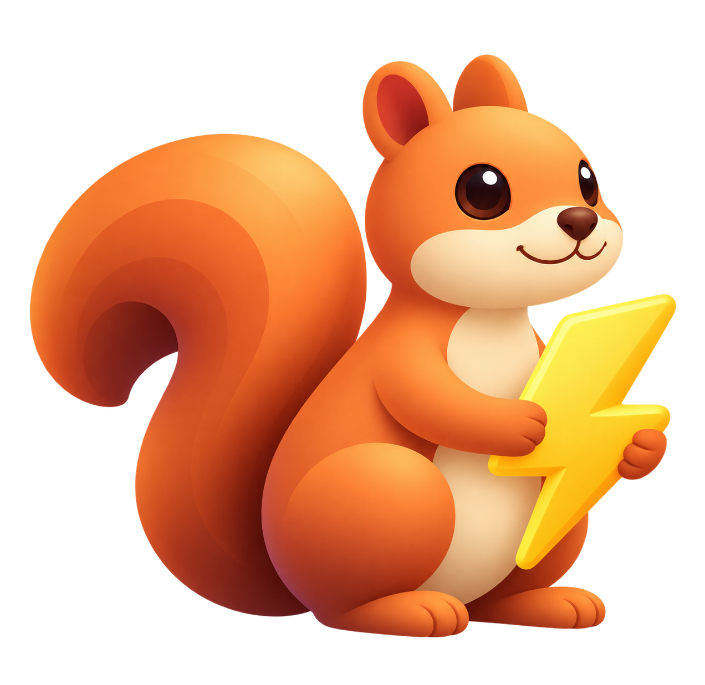
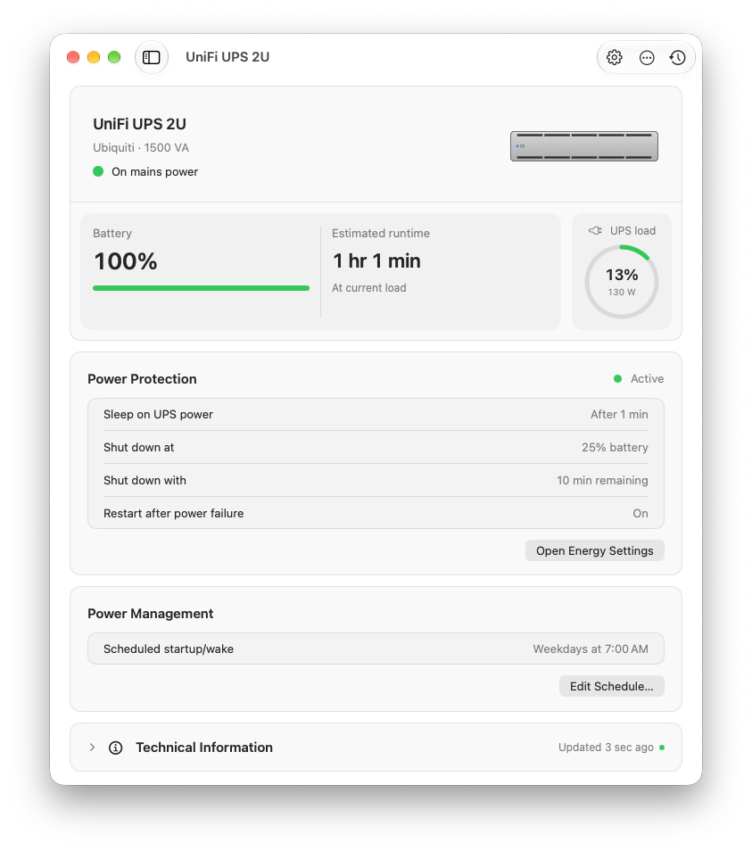

<p align="center">
  
</p>

<h1 align="center">Squirrel</h1>

<p align="center"><strong>Lets your Mac see the UPS on your network.</strong></p>

<p align="center">
  Squirrel reads your UPS from a Network UPS Tools (NUT) server and hands it to macOS as a real power source, so the Mac's own UPS shutdown settings work.
</p>

<p align="center">
  <a href="https://github.com/johnwatso/Squirrel/releases"><strong>Download Squirrel</strong></a> ·
  <a href="Documentation/README.md">Documentation</a> ·
  <a href="https://github.com/johnwatso/Squirrel/releases">GitHub Releases</a>
</p>

<p align="center">
  
  
  
</p>

<p align="center">
  <picture>
    <source media="(prefers-color-scheme: dark)" srcset="Documentation/Images/overview-dark.png">
    <source media="(prefers-color-scheme: light)" srcset="Documentation/Images/overview-light.png">
    
  </picture>
</p>

## Highlights

- Publishes your UPS to macOS, so it appears in System Settings → Energy and `pmset -g ps`, and macOS performs the shutdown itself
- No `sudo`, no sudoers edits and no helper: macOS's built-in UPS thresholds do the work
- A setup assistant that finds NUT servers on your network and lists their UPSes
- Battery, runtime, load and power at a glance, in the menu bar and a native window
- Power history and an event log for outages, low battery and lost connections
- Optional notifications, and keeping the Mac awake during an outage so it reaches its shutdown rule
- Power schedules for start-up, sleep, restart and shutdown, using macOS's own recurring slots
- Several UPSes at once, with one shared with macOS
- Shortcuts actions and a bundled `squirrelctl` command for automation
- Update checks through Sparkle

## Installation

Download the latest release from [GitHub Releases](https://github.com/johnwatso/Squirrel/releases) and move Squirrel to your Applications folder. Open it and follow the setup assistant.

You'll need macOS 13 or later, and a NUT server for your UPS that this Mac is allowed to reach. Allow Local Network access when macOS asks.

## How it works

Squirrel polls the NUT server and publishes the selected UPS to macOS as a power source through IOKit, so the Mac sees it as its own UPS. macOS owns the shutdown policy; set your thresholds under **System Settings → Energy → UPS Options**. Squirrel's **Power Protection** card shows whether macOS sees the UPS, which rules are set, and whether the Mac restarts when power returns.

A few things to know:

- Squirrel must keep running. Quitting or pausing it removes the UPS from macOS.
- The IOKit functions it uses ship in macOS but aren't in the public headers. If a future macOS stops accepting them, Squirrel falls back to monitoring and says so.
- The NUT connection is plain TCP. Use it on a trusted network, or over a VPN.
- macOS recognising the UPS doesn't prove a shutdown works. Test one outage before relying on it.

## Development

Squirrel is an Xcode project built with Swift 6 and SwiftUI. The project is generated from [project.yml](project.yml) with XcodeGen, and Sparkle comes in through Swift Package Manager.

```sh
open Squirrel.xcodeproj
xcodebuild test -project Squirrel.xcodeproj -scheme Squirrel -destination 'platform=macOS'
```

Start with the [documentation index](Documentation/README.md) and the [design notes](DESIGN.md).

## Releases

[GitHub Releases](https://github.com/johnwatso/Squirrel/releases) contain stable, signed builds. The `main` branch may include unreleased work.

## Licence

Squirrel is available under the [MIT License](LICENSE).
